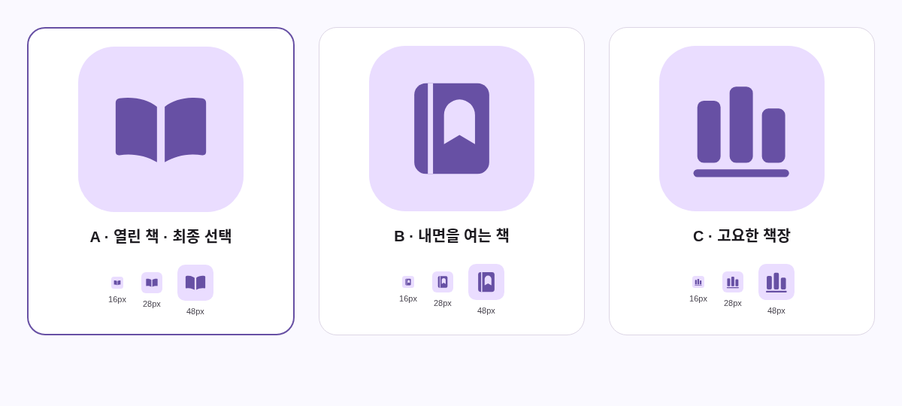

# 내면의 서재 아이콘 시안

2026-11-24, Material 3의 primary-container(#eaddff)와 primary(#6750a4)를 적용했다.

- **A · 열린 책 — 최종 선택.** 두 면과 중앙 여백만으로 서재를 표현한다. 16px 파비콘과 28px 헤더에서 식별하기 쉽고, 기존 책 모티프도 이어진다.
- B · 내면을 여는 책. 책 안의 문과 책갈피가 성찰을 상징하지만 작은 크기에서는 내부 형태가 뭉친다.
- C · 고요한 책장. 자료가 쌓이는 서재를 표현하지만 작은 크기에서는 막대그래프처럼 보일 수 있다.

최종 `assets/icon.svg`는 A안의 형태를 유지한다. 2026-11-25에는 사이트 블루 테마와 맞춰 책 #0b57d0, 배경 #d3e3fd로 색상만 변경했다. 위 시안은 최초 선택 당시의 보라색 비교 기록이다. 512px·180px PNG는 동일 SVG를 해당 크기의 투명 캔버스에 렌더링했다. 세 시안 모두 외부 글꼴·이미지·스크립트를 사용하지 않는다. 생성 이미지로 방향을 탐색한 뒤 실제 배포 파일은 단색 벡터로 정리했다.
